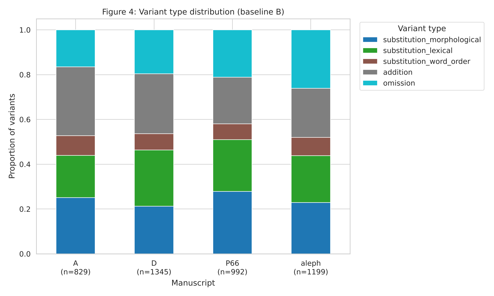

# Manuscript Textual Profile Analysis Engine

[Interactive Website](https://agnieszkachr.github.io/scribal-fingerprints/) · [GitHub Repository](https://github.com/Agnieszkachr/scribal-fingerprints)
[](https://doi.org/10.5281/zenodo.19153695)

This repository contains the codebase, extraction pipelines and analytical scripts for a
computational analysis of textual variation in five major Greek witnesses to the Gospel
of John (P66, Codex Sinaiticus, Codex Alexandrinus, Codex Vaticanus, Codex Bezae).
The project asks whether the witnesses possess statistically detectable, reproducible
**manuscript-level change profiles**, combining a classical typology of variants
(addition, omission, word order, morphological and lexical substitution) with contextual
embeddings of the variant loci (`Ancient-Greek-BERT`).

## Important Methodological Note

The profiles reflect the aggregate textual tradition of a witness and may be influenced by:

1. Text-type affiliation (Alexandrian, Western, Byzantine)
2. Exemplar tradition inherited by the copyist
3. Individual scribal habits and preferences

**The current methodology cannot disentangle these factors.** Profiles should be read as
manuscript-level characteristics, not as fingerprints of an individual scribe.

## Known Limitations

- **Text-type confound.** The five witnesses belong to different text-types, so part of
  any profile separation reflects text-type rather than scribal behaviour.
- **Lemmatisation.** Morphological and lexical substitutions are separated by a character
  similarity heuristic (threshold 0.5), not by a lemmatiser; compounds and stem changes
  that share many letters (e.g. ιουδαιαν → γαλιλαιαν) can be mis-filed as morphological.
- **Embedding model.** `Ancient-Greek-BERT` was trained mostly on Classical Greek; its
  behaviour on unaccented Koine transcriptions has not been validated independently.
- **Dependence between observations.** Several variants can occur in one verse and their
  context windows overlap. Inference therefore uses chapter-level blocks (bootstrap and
  permutation), and the embedding report additionally gives a verse-level effect size.

## Key Results (variant typology, current extraction)

<p align="center">
  
</p>

Against Codex Vaticanus (B) as the baseline, 4,460 variants are extracted.
Additions and omissions together make up 39–48 % of the variants of each witness,
morphological substitutions 30–37 %, lexical substitutions 12–18 % and word-order shifts
6–9 %. The variant-type distributions differ significantly between witnesses
(`outputs/typology_report_B.txt`):

| Test (baseline B, N = 4,460) | Cramér's V [95 % block-bootstrap CI] | Permutation null (mean ± SD) | p |
|---|---|---|---|
| Substitution / addition / omission | 0.090 [0.071 – 0.109] | 0.025 ± 0.008 | 0.005 |
| Morphological / lexical / word order | 0.074 [0.051 – 0.112] | 0.036 ± 0.010 | 0.010 |

P66 shows the largest share of both lexical and morphological substitutions in every
configuration (baseline B, baseline A, baseline ℵ and the verse-matched subset);
Alexandrinus has the largest share of additions and Sinaiticus the largest share of
omissions against B (see `outputs/type_counts_full_*.csv` and
`outputs/typology_report_*.txt`).

### Embedding-based results

The embedding stage (`profile_scribes.py`) requires the BERT model and is not part of
this repository's data. The embedding-based output files in `outputs/`
(`pilot_report_full_*`, `pilot_results_full_*`, `chapter_stability_*`,
`cumulative_analysis_*`, `fig1_*`, `fig2_*`, `fig6_*`, `fig7_*`) are refreshed by steps
4–6 of the pipeline below; the website marks values that await that run.

## Repository Structure

```text
├── LICENSE                             # MIT License
├── README.md                           # This file
├── CITATION.cff                        # Citation metadata
├── requirements.txt                    # Python package dependencies
├── download_itsee_data.py              # Fetches the ITSEE TEI XML and runs the extraction for one baseline
├── src/
│   ├── extract_variants.py             # TEI parsing, alignment, classification (shared with the SCRIPTA pipeline)
│   ├── download_itsee_data.py          # ITSEE download and verse-id parsing
│   ├── config.py, corpus_registry.py   # Paths, witnesses, versification
│   └── utils/
│       ├── token_normalizer.py         # Surface forms and orthographic normalisation
│       └── nomina_sacra.py             # Expansion table for the attested nomina sacra
├── create_verse_matched_dataset.py     # Verse-matched subset: verses attested in all five witnesses
├── run_ablation_study.py               # Function-words-only, content-masked and random-masked (control) datasets
├── profile_scribes.py                  # Ancient-Greek-BERT embeddings, change vectors, manuscript and chapter profiles
├── run_statistical_tests.py            # Block bootstrap / permutation inference (Cramér's V, Cohen's d, ARI, split-half)
├── create_visualizations.py            # Figures (PCA, dendrogram, type distribution, cumulative ARI, stability heatmap)
├── recalc_odd_even.py                  # Utility: refresh only the split-half lines of existing reports
├── data/
│   ├── raw/john/                       # Raw ITSEE transcriptions (one file per witness)
│   ├── variants_full_john_{B,A,aleph}.csv   # Variants against each baseline
│   ├── variants_ablation_{matched,func_words,masked,random_masked}.csv
│   └── common_extant_verses.txt        # 532 verses with attested text in all five witnesses
├── outputs/                            # Type counts, coverage report, statistical reports, figures
└── docs/                               # Static companion website (GitHub Pages)
```

## Methodological Details

### Transcription processing (`src/extract_variants.py`)

- Only the **first-hand text** is read: inside `<app>` the reading with `type="orig"` is
  used and corrector readings are ignored.
- Only the outermost `<w>` of a nested pair is read. Words split across line, column or
  page breaks (`<lb break="no"/>` inside `<w>`; `<w part="I">` + `<w part="F">` across
  `<ab>`) are joined; marginal sigla (`<seg type="margin">`), punctuation, running titles
  (`<fw>`) and notes are dropped.
- **Nomina sacra** (`<abbr type="nomSac">`) are expanded from a table of the attested
  abbreviations (θς → θεος, πρς → πατρος, ανος → ανθρωπος, ιης → ιησους, …); the
  supralinear stroke for final nu (`¯`) is resolved to ν.
- Tokens are lower-cased and stripped of diacritics (accents, breathings, diaeresis,
  iota subscript) and of every non-letter character. Tokens that contain editorially
  `<supplied>` text or a `<gap>` are flagged `reconstructed`, tokens containing
  `<unclear>` text are flagged `uncertain`; both count as attested by default.
  `--exclude-supplied` / `--exclude-unclear` drop the variant blocks that rest on such
  tokens (a robustness configuration; the counts dropped are printed).
- Verses with no attested text (lacunae; John 5:4; 7:53–8:11 where absent) are skipped;
  the coverage report counts only verses with text.

### Orthographic normalisation

Alignment is computed on normalised tokens so that the following alternations neither
break the alignment nor count as variants:

- itacism: ει/ι, η/ι, οι/υ/ι, αι/ε, and ω/ο (the digraph ου is protected);
- movable nu in the endings -σι(ν) and -ε(ν) (never in εν, μεν, ην, ουδεν, μηδεν, …) and
  movable sigma (ουτως/ουτω, αχρις/αχρι, μεχρις/μεχρι);
- elision (αλλ’/αλλα, δι’/δια, μετ’/μετα, …);
- consonant gemination (ιωανης/ιωαννης);
- final sigma and letter case.

The surface forms in the CSVs keep the transcribed spelling.

### Alignment and classification

Each manuscript verse is aligned with the baseline verse by `difflib.SequenceMatcher`
(longest common subsequence, `autojunk=False`). Every non-equal block becomes one variant:

- `insert` → **addition**; `delete` → **omission**;
- `replace` with the same multiset of words → **word-order shift**;
- `replace` otherwise → **substitution**, morphological if the character similarity of the
  normalised readings exceeds 0.5 (averaged over positionally paired words when the block
  lengths are equal, computed on the joined strings otherwise), lexical if not;
- after alignment, an omission and an addition (or two substitutions) of the same words
  within eight baseline tokens of each other are merged into one **word-order shift**,
  since the LCS alignment never emits a transposition as a single block.

Unequal replace blocks (e.g. two words replaced by one) are kept as single substitution
units; `n_base_words` and `n_ms_words` record the block shape. Each variant carries a
context window of five words on either side in the baseline and in the manuscript.

### Embeddings (`profile_scribes.py`)

Each context window is embedded with `pranaydeeps/Ancient-Greek-BERT`; the 768-d vector is
the attention-masked mean of the last-layer token vectors. The **change vector** of a
variant is `embedding(manuscript context) − embedding(baseline context)`. A manuscript
profile is the mean change vector of its variants; chapter profiles likewise.

### Feature isolation (`run_ablation_study.py`)

Three derived datasets probe what the embedding separation rests on:

- **function words only** – the variants whose two readings consist entirely of function
  words (articles, pronouns, particles, conjunctions, prepositions, negations); the
  context windows are untouched;
- **content masked** – every variant, with each content word in the readings and in the
  context windows replaced by `CONTENT`, so that only the function words and the word
  positions remain visible to the model;
- **random masked (control)** – every variant, with the same *number* of words per field
  replaced by `CONTENT` as under content masking, but at positions drawn at random
  (seeded per variant) irrespective of word class. The difference between the two masked
  conditions isolates the effect of *which* words are hidden from the effect of how many.

### Statistical framework (`run_statistical_tests.py`)

- Distances between change vectors and between profiles are **cosine** distances.
- **Cohen's d** compares inter-manuscript with intra-manuscript pairwise distances on a
  random subsample of 1,000 variants; a 95 % CI comes from a chapter-level block bootstrap
  (B = 100) and the null from chapter-restricted label permutations (100). The report also
  gives d within each variant class, d for every pair of witnesses, and d after averaging
  the change vectors per verse and manuscript.
- **ARI** compares k-means clusters (k = number of witnesses, `n_init=10`, seed 42, at most
  3,000 variants) with the manuscript labels; null by chapter-restricted permutation (200).
- **Cramér's V** on the variant-type contingency tables, with a chapter-level block
  bootstrap (B = 200) and chapter-restricted permutations (200).
- Permutation p-values are reported as (k + 1)/(B + 1).
- **Split-half replicability**: Spearman ρ between the six inter-manuscript centroid
  distances computed on odd and on even chapters, with and without restriction to the
  532 verses attested in all witnesses; in addition the full odd/even centroid distance
  matrix and the paired distances are written to `outputs/split_half_*.csv`.

## Pipeline Execution

```bash
# 1. Install dependencies
pip install -r requirements.txt

# 2. Extract variants (downloads the ITSEE XML on first run); writes data/variants_full_john_<MS>.csv,
#    outputs/type_counts_full_<MS>.csv and outputs/coverage_report.csv
python download_itsee_data.py --baseline B
python download_itsee_data.py --baseline A
python download_itsee_data.py --baseline aleph
python download_itsee_data.py --baseline B --exclude-supplied   # robustness configuration

# 3. Derived datasets
python create_verse_matched_dataset.py
python run_ablation_study.py

# 4. Embeddings (needs torch + transformers and the Ancient-Greek-BERT model)
python profile_scribes.py --baseline B
python profile_scribes.py --baseline A
python profile_scribes.py --ablation matched
python profile_scribes.py --ablation func_words
python profile_scribes.py --ablation masked
python profile_scribes.py --ablation random_masked
python profile_scribes.py --baseline aleph

# 5. Statistics (add --typology-only to run the variant-type tests without embeddings)
python run_statistical_tests.py --baseline B
python run_statistical_tests.py --ablation matched      # etc.

# 6. Figures
python create_visualizations.py --baseline B
python create_visualizations.py --ablation matched      # etc.

# 7. Website data
cd docs && python prepare_website_data.py
```

## Output Interpretation

Manuscript profiles capture manuscript-level patterns of textual variation. High
similarity between profiles may indicate shared text-type affiliation, a common exemplar
tradition, similar scribal training, or geographic/temporal proximity. The profiles do
not prove individual scribe identification, do not distinguish intentional from
unintentional changes, and say nothing about the direction of change (which requires a
genealogical method such as the CBGM).

## Relationship to Existing Methods

The Coherence-Based Genealogical Method used in the Editio Critica Maior addresses
genealogical relationships and textual flow; this tool characterises aggregate change
profiles. Traditional scribal-habits studies (Royse, Head, Hernández) identify tendencies
of specific manuscripts by manual analysis; this tool offers automated, corpus-scale
counts and effect sizes with uncertainty, but cannot attribute patterns to individual
scribes rather than to the tradition.

## Interactive Website

[https://agnieszkachr.github.io/scribal-fingerprints/](https://agnieszkachr.github.io/scribal-fingerprints/)

A static HTML/CSS/JS companion site in `docs/` (GitHub Pages) with interactive Plotly
charts, a manuscript coverage table and a searchable explorer of ~2,000 sampled variants.
Serve locally with `cd docs && python -m http.server 8080`; regenerate its data files with
`python prepare_website_data.py` from the `docs/` directory.

## License

This project is licensed under the [MIT License](LICENSE).

## Citation

If you use this code or data, please cite:

> Ziemińska, A. B. (2026). *The Typological Structure of Textual Variation: A Computational Analysis of Major Witnesses to the Gospel of John.* Zenodo. https://doi.org/10.5281/zenodo.19153695

```bibtex
@article{zieminska2026scribal_software,
  author    = {Ziemińska, Agnieszka B.},
  title     = {The Typological Structure of Textual Variation:
               A Computational Analysis of Major Witnesses
               to the Gospel of John (Software & Data)},
  year      = {2026},
  publisher = {Zenodo},
  doi       = {10.5281/zenodo.19153695},
  url       = {https://doi.org/10.5281/zenodo.19153695}
}
```
